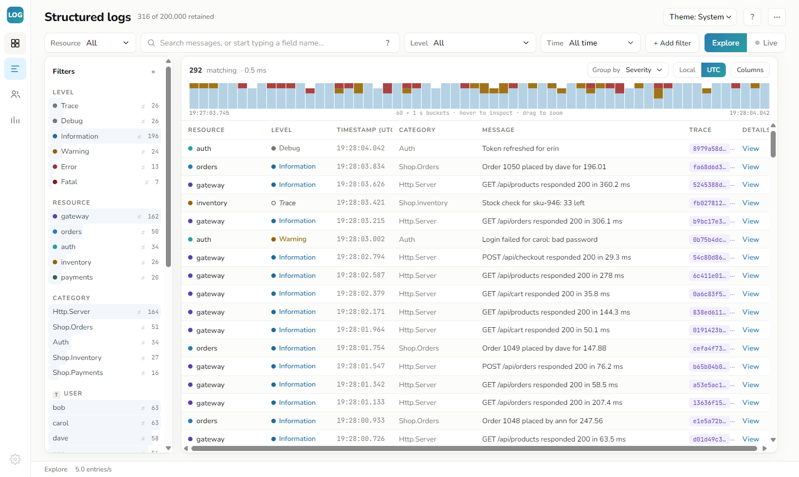
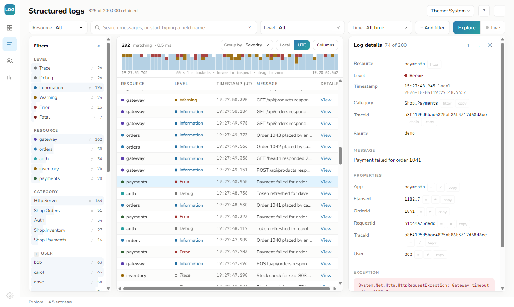
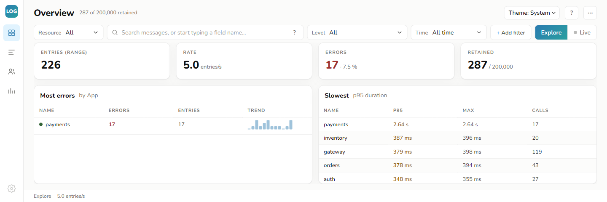
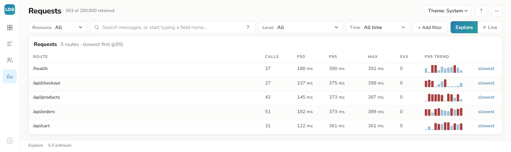

# LogLens

**Structured logging for .NET, with its own log viewer.**

LogLens is two things that work together (and separately):

1. **A logging library** — small, fast, dependency-light, targeting `net10.0` and `netstandard2.0`. Message templates, scopes, rolling files, async sinks, never throws into your code.
2. **A log viewer** — a self-hosted web app (`loglens`) with plain-language search, facets, dashboards, live tail and a chain-of-events timeline. It also speaks **Seq's ingestion protocol** and **OTLP**, so existing Serilog and OpenTelemetry apps can use it with **zero new packages**.



```
┌─ your app ──────────────────┐        ┌─ LogLens.Viewer ─────────────────┐
│ LogLens  ──HTTP/NDJSON──►│        │ http://localhost:5341               │
│ Serilog     ──Seq (CLEF)───►│───────►│ search · facets · histogram · live  │
│ OpenTelemetry ──OTLP───────►│        │ Users · Requests · Chain · profile  │
│ NDJSON files ──--tail──────►│        │ in-memory ring buffer, no database  │
└─────────────────────────────┘        └─────────────────────────────────────┘
```

---

## Quick start

### 1. Run the viewer

```bash
# as a global tool
dotnet tool install -g LogLens.Viewer
loglens

# or from source, with synthetic traffic to explore the UI
dotnet run --project src/LogLens.Viewer -- --demo

# or as a container
docker build -t loglens/viewer -f src/LogLens.Viewer/Dockerfile .
docker run -p 5341:5341 loglens/viewer
```

Open **http://localhost:5341**. The empty state shows the exact setup snippet for your stack.

### 2. Send logs — pick your stack

| You use… | Add this | New packages |
|---|---|---|
| **Serilog** | `.WriteTo.Seq("http://localhost:5341")` — the stock Seq sink works unchanged | none |
| **ASP.NET Core / `ILogger`** | `builder.Logging.AddLogLens(builder.Configuration.GetSection("Logging:LogLens"));` | `LogLens.Extensions.Logging` |
| **OpenTelemetry** | `.AddOtlpExporter(o => { o.Endpoint = new Uri("http://localhost:5341/v1/logs"); o.Protocol = OtlpExportProtocol.HttpProtobuf; })` | none |
| **Any .NET app** | `Log.Logger = new LoggerConfiguration().WriteTo.Http("http://localhost:5341").CreateLogger();` | `LogLens.Core`, `LogLens.Sinks.Http` |
| **Log files only** | `loglens --tail C:\logs` (NDJSON / CLEF files) | none |

### 3. Correlate

Wrap a unit of work in a scope and every entry inside it — across `await`s and across loggers — carries the id. That id powers the Trace column, the chain timeline and the dashboards:

```csharp
using (Log.BeginScope("OrderId", orderId))         // Serilog: LogContext.PushProperty
{
    Log.Info("Order {OrderId} received", orderId); // ASP.NET Core adds RequestId per
    await Process(orderId);                        // request automatically; add
    Log.Info("Order shipped");                     // ActivityTrackingOptions for TraceId
}
```

---

## The library

```csharp
using LogLens;
using LogLens.Configuration;

Log.Logger = new LoggerConfiguration()
    .MinimumLevel(LogLevel.Debug)
    .Enrich("App", "MyService")                                            // on every event
    .WriteTo.Console(ConsoleTheme.Ansi, restrictedToMinimumLevel: LogLevel.Information)
    .WriteTo.File("logs/app-.log", RollingInterval.Day, retainedFileCount: 7)
    .WriteTo.File("logs/app-.json", new JsonFormatter(), RollingInterval.Day)
    .WriteTo.Http("http://localhost:5341")                                 // → the viewer
    .Async()                                                               // background queue
    .CreateLogger();

Log.Info("User {UserId} logged in from {Ip}", 42, "10.0.0.1");
Log.Error(ex, "Payment failed for {OrderId}", 1003);
Log.CloseAndFlush();                                                       // drain at shutdown
```

**What you get**

- **Message templates** — `{Name}`, `{Name:format}`, `{Name,align}`, `{{` escapes. Named arguments become structured, queryable properties.
- **Levels** Trace → Fatal. Disabled levels cost nothing (generic overloads avoid boxing; `IsEnabled` short-circuits).
- **Sinks** — Console (plain/ANSI), rolling File (interval and/or size, retention), Debug, TextWriter, InMemory (for tests), HTTP (batched, retrying). Each sink can have its own `restrictedToMinimumLevel`.
- **Formatters** — text with a configurable output template, JSON (one object per line, NDJSON), or logfmt (`ts=… level=info msg="…" key=value`, readable *and* structured — `new LogfmtFormatter()` works everywhere a formatter is accepted).
- **`.Async()`** — bounded background queue; overflow policies `DropOldest` / `DropNewest` / `Block`; graceful drain on dispose.
- **Scopes & context** — `BeginScope` (async-local, flows through `await`) and `ForContext` (fixed properties on a child logger).
- **Never throws** — sink and formatter failures go to `SelfLog.Output` (off by default), never into your call site.
- **MEL provider** — `LogLens.Extensions.Logging` routes `ILogger<T>` through LogLens, including categories, `EventId`, scopes and `{OriginalFormat}` templates.

**ASP.NET Core configuration** (`appsettings.json` — every value also works as `Logging__LogLens__…` environment variables):

```jsonc
"Logging": {
  "LogLevel": { "Default": "Information", "Microsoft.AspNetCore": "Warning" },
  "LogLens": {
    "MinimumLevel": "Debug",
    "Viewer": "http://localhost:5341",
    "ApiKey": null,
    "ViewerMinimumLevel": "Information",
    "Console": true,
    "File": { "Path": "logs/app-.json", "Rolling": "Day", "Retain": 7, "Json": true, "MinimumLevel": "Debug" },
    "Enrich": { "App": "MyService" }
  }
}
```

```csharp
builder.Logging.AddLogLens(builder.Configuration.GetSection("Logging:LogLens"));
builder.Logging.Configure(o => o.ActivityTrackingOptions =
    ActivityTrackingOptions.TraceId | ActivityTrackingOptions.SpanId);   // trace correlation for free
```

---

## The viewer

One process, no database. Events live in a bounded in-memory ring buffer (default 200 000, `--capacity`); Warning-and-above events that fall off the ring survive in a smaller protected buffer (default capacity ⁄ 8, `--protected-capacity`), so a debug flood can't flush out your errors. Files tailed with `--tail` are re-read on restart. Measured on a laptop: ~100 k events/s ingest, 25–120 ms queries at a full 200 k-event store.

### Search without a query language

Type words to search messages. Start typing a field name (`Ord…`) and pick a suggestion — the viewer offers the fields and values it has actually seen. Or use **+ Add filter** (Field · Condition · Value). Active filters show as plain-English chips: *"Level is at least Warning", "OrderId is 1002"*.

Power users can type the short form directly (it is also the URL format, so views are shareable):

| Syntax | Meaning |
|---|---|
| `payment failed` / `"payment failed"` | words (ANDed) / exact phrase |
| `-health` | exclude any term |
| `level:error` · `level:warning+` | exact level · that level and above |
| `category:Shop.Orders` · `category:Shop.*` | exact category · wildcard at either end |
| `OrderId=1002` · `Status!=200` · `User~admin` | property equals / not equals / contains |
| `Elapsed>500` · `Pct<=90` | numeric compare |
| `has:RequestId` · `has:exception` | property present / has an exception |

### Pages

- **Structured logs** — the explorer: severity-stacked histogram (drag to zoom), facet panel (click to filter, `≠` to exclude), data grid, details pane (local + UTC time, highlighted template, per-property filter/exclude/copy, exception block, raw JSON, permalink). **Explore** mode is a calm snapshot; **Live** streams new entries (batched, queued behind a "▲ N new" pill while you read; Pause buffers).
- **Overview** — entries, rate, error %, retained; most-errors and slowest tables.
- **Users** — who is doing what: entries, errors, last seen, top activity, error-rate bar per user (identity key auto-detected: `User`, `UserId`, `Customer`, `TenantId`…).
- **Requests** — long-running calls: per route p50 / p95 / max, 5xx count, p95 trend sparkline, one click to the slowest entry (`Route` × `Elapsed`, auto-detected; ASP.NET Core request logging provides both out of the box).
- **Chain** — click any Trace chip: every entry sharing one correlation id (`TraceId` → `CorrelationId` → `DocumentId` → `RequestId`), oldest first, with relative times, flagged gaps, per-service colour lanes and a Problems-only toggle. This is "what happened to this request/order/document, in order, across services."

Keyboard: `/` search · `j`/`k` move · `Enter` details · `l` Live · `Esc` close. Theme: System / Light / Dark.

### Screenshots

**Log details** — click any row for properties, exception, raw JSON and one-click filters.



**Overview** — volume, rate, error share, and the noisiest / slowest services at a glance.



**Requests** — per-route latency percentiles with a p95 trend.



### Domain profile — tune it to *your* domain

```bash
loglens --profile shop.profile.json
```

```jsonc
{
  "name": "Shop",
  "entities": { "OrderId": { "label": "Order", "link": "https://admin.example.com/orders/{value}" } },
  "quickViews": [ { "name": "Failed payments", "query": "category:Shop.Payments level:error" } ],
  "redact": [ "CardNumber", "Email" ],                       // masked as ••• in every response
  "keys": { "identity": ["Customer"], "duration": ["Elapsed"],
            "route": ["Route"], "correlation": ["OrderId"] } // overrides auto-detection
}
```

Entities get labels and "Open ↗" links in the details pane; quick views become one-click filter chips; redacted properties never leave the server unmasked. Example: `samples/profiles/docs.profile.json`.

### Viewer configuration

| Option | CLI | Config / env | Default |
|---|---|---|---|
| Ring-buffer capacity | `--capacity 300000` | `Viewer:Capacity` | 200 000 |
| Protected warn+ buffer (0 = off) | `--protected-capacity 50000` | `Viewer:ProtectedCapacity` | capacity ⁄ 8 |
| Tail files/directories | `--tail PATH` (repeatable) | `Viewer:Tail:0` | — |
| API key (guards ingest & delete) | `--api-key KEY` | `Viewer:ApiKey` | off |
| Domain profile | `--profile FILE` | `Viewer:Profile` | — |
| Demo traffic | `--demo` | — | off |
| Listen URL | — | `ASPNETCORE_URLS` | `http://localhost:5341` |

> The viewer has no authentication of its own beyond the API key — run it on localhost or behind your reverse proxy (TLS/SSO). History beyond the in-memory buffer is v2 (see Roadmap).

### HTTP API

| Endpoint | Purpose |
|---|---|
| `POST /api/ingest` | NDJSON or JSON array (LogLens `JsonFormatter` shape) |
| `POST /ingest/clef` · `POST /api/events/raw` | **Seq-compatible** CLEF ingestion (`application/vnd.serilog.clef`, `X-Seq-ApiKey`) |
| `POST /v1/logs` | **OTLP/HTTP** logs (binary protobuf) |
| `GET /api/events?q=&from=&to=&limit=&before=` | query: events + facets + histogram (`from`/`to` ISO or relative `-15m`) |
| `GET /api/events/{seq}` | one event |
| `GET /api/aggregate?by=&duration=&q=…` | dashboard groupings (counts, p50/p95/max, 5xx, trends) |
| `GET /api/stream?q=` | live tail (Server-Sent Events) |
| `GET /api/stats` · `GET /api/profile` | store stats · active domain profile |
| `DELETE /api/events` | clear the store (needs the API key when set) |

---

## Repository layout

```
src/LogLens/                    core library (net10.0 + netstandard2.0)
src/LogLens.Extensions.Logging/ Microsoft.Extensions.Logging provider + configuration binding
src/LogLens.Sinks.Http/         batched HTTP sink for the viewer
src/LogLens.Viewer/             the viewer (ASP.NET Core minimal API + Vue 3 / Vite)
tests/LogLens.Tests/            library tests (xUnit)
tests/LogLens.Viewer.Tests/     viewer tests (store, DSL, API, ingestion, OTLP)
tests/js/                          front-end DSL tests (node --test)
samples/LogLens.Sample/         console app exercising the library
samples/LogLens.UploadDemo/     correlated multi-service chain demo (BeginScope)
samples/LogLens.SerilogDemo/    plain Serilog app → viewer via the stock Seq sink
samples/profiles/                  example domain profile
docs/images/                       README screenshots
```

## Building and testing

```bash
dotnet build                          # warnings are errors
dotnet test                           # 151 tests
node --test tests/js/*.test.mjs       # 5 front-end DSL tests
dotnet format --verify-no-changes     # style
dotnet run --project src/LogLens.Viewer -- --demo
```

CI (`.github/workflows/ci.yml`) runs all of the above on Windows + Linux and packs the four NuGet packages (`LogLens.Core`, `LogLens.Extensions.Logging`, `LogLens.Sinks.Http`, `LogLens.Viewer` as a dotnet tool).

> **Why `LogLens.Core` and not `LogLens`?** The bare `LogLens` id on nuget.org is held by an unrelated placeholder package (checked 2026-08-30); the `LogLens.*` ids are ours.

## Roadmap (v2)

- Persistence beyond the ring buffer (SQLite/Parquet) with retention policies
- Alerts from saved queries · pattern clustering · saved views on the server
- Span-aware waterfall (upgrade of the chain view) · `{@x}` destructuring in the library

## License

MIT — see [LICENSE](LICENSE).
